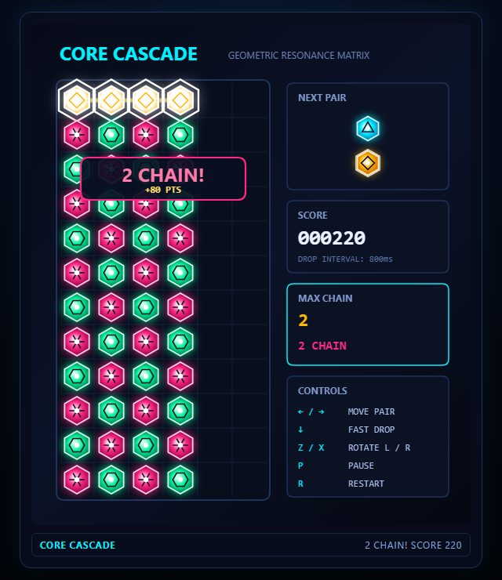

# CORE CASCADE

ブラウザで遊べる、オリジナルの落ちものパズルです。

**遊ぶ:** https://asanote.github.io/core-cascade/



## 遊び方

2個1組のコアが落ちてきます。上下左右に同じ色が4個以上つながると消え、続けて消えると連鎖になって得点が倍になります。

| キー | 操作 |
|---|---|
| ← → | 移動 |
| ↓ | 高速落下 |
| Z / X | 左回転 / 右回転 |
| P | 一時停止 |
| R | リスタート |

## 作り方

Claude Code の使用量を抑えるサンプル「magi-system」の成果物です。Claude は設計と取りまとめだけを担当し、コードは2つのツールに任せました。

- ゲームのロジック（`src/logic/`）とテスト: Codex
- 画面・入力・効果音（`src/ui/`、`index.html`）: Google Antigravity

外部ライブラリは使っていません（HTML + JavaScript + Canvas）。

## 手元で動かす

ES Modules を使うため、ファイルを直接開くのではなく、静的サーバー経由で開いてください。

```bash
npx serve .
```

テスト（Node.js 24 以上）:

```bash
npm test
```
